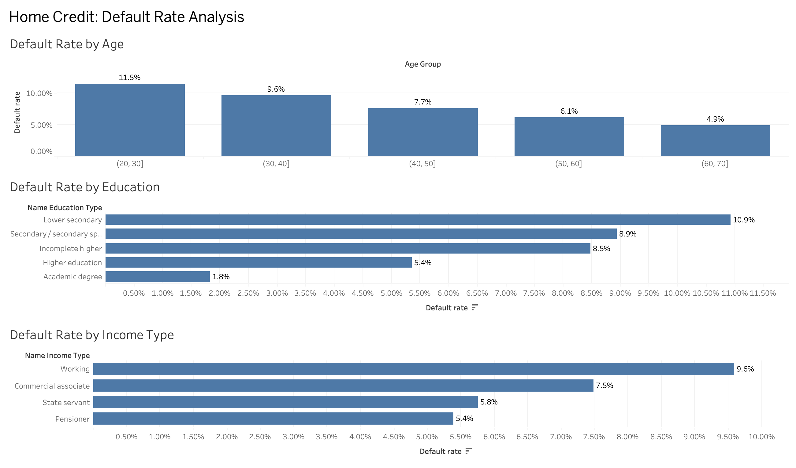
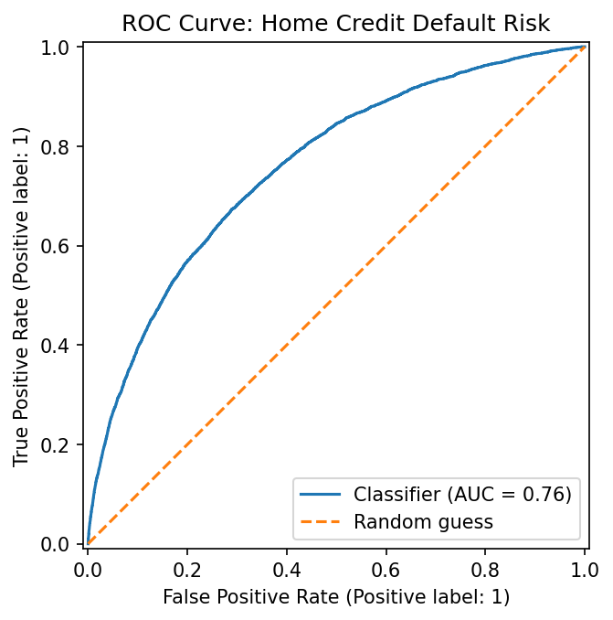

# Home Credit Default Risk

Loan default risk analysis and prediction on the Home Credit dataset, using Python, SQL (SQLite), Tableau and a machine learning classifier.

## Project Overview

Home Credit serves clients with little or no credit history. This project explores which client characteristics are linked to payment difficulties (TARGET = 1) and builds a model to predict default. It has four layers, each one in its own folder:

1. Python EDA: data quality checks, feature engineering and default rate analysis.
2. SQL: the same questions answered with SQLite queries.
3. Tableau: a dashboard with the main default rate patterns.
4. Classification model: a gradient boosting classifier evaluated with ROC AUC, precision and recall.

## Dataset

- Source: [Home Credit Default Risk (Kaggle)](https://www.kaggle.com/competitions/home-credit-default-risk)
- File used: application_train.csv (307,511 loans, 122 columns)
- Imbalanced target: 8.07% of clients had payment difficulties (24,825 of 307,511)

The raw data is not included in this repository because of file size. To reproduce the project, download application_train.csv from Kaggle and place it in a folder called data at the project root.

## Key Findings

- DAYS_EMPLOYED has a placeholder value (365243) in 55,374 rows, almost all pensioners. I replaced it with NaN and created a DAYS_EMPLOYED_MISSING flag to keep that information.
- Default rate falls with age: 11.5% for clients aged 20 to 30 versus 4.9% for clients aged 60 to 70.
- Default rate falls with education: 10.9% for Lower secondary versus 5.4% for Higher education. Academic degree shows 1.8%, but it has only 164 clients, so that rate is not reliable.
- Among income types with at least 1,000 loans, Working has the highest default rate (9.6%) and Pensioner the lowest (5.4%).
- The classifier reaches a ROC AUC of 0.76 on unseen data. It finds 67% of the clients who default (recall), with 17% precision, about twice the 8% base rate.

## Dashboard

## Model Performance

Accuracy is a misleading metric here, since a model that predicts "no default" for everyone would score 92%. For that reason the model is evaluated with ROC AUC, precision and recall, and trained with balanced class weights.

## Repository Structure

- notebooks/01_eda.ipynb: data quality, feature engineering and default rate analysis (pandas)
- notebooks/02_sql.ipynb: SQLite queries run from Python
- notebooks/03_tableau_export.ipynb: exports the dataset used in Tableau
- notebooks/04_model.ipynb: classification model and evaluation
- sql/01_default_rate_analysis.sql: the SQL queries as a standalone file
- outputs/: dashboard image, ROC curve and the Tableau workbook (home_credit_dashboard.twb)

To rebuild the Tableau data source (tableau_data.csv, too large for GitHub), run notebook 03. To open the workbook, reconnect it to that file in Tableau.

## Tools

Python (pandas, NumPy, matplotlib, scikit-learn), SQLite, Tableau Desktop, Jupyter

## Next Steps

- Add the other Kaggle tables (bureau, previous applications) to improve the ROC AUC.
- Tune the decision threshold based on the cost of a missed default versus a rejected good client.
- Explain the model with feature importance (permutation importance or SHAP).
